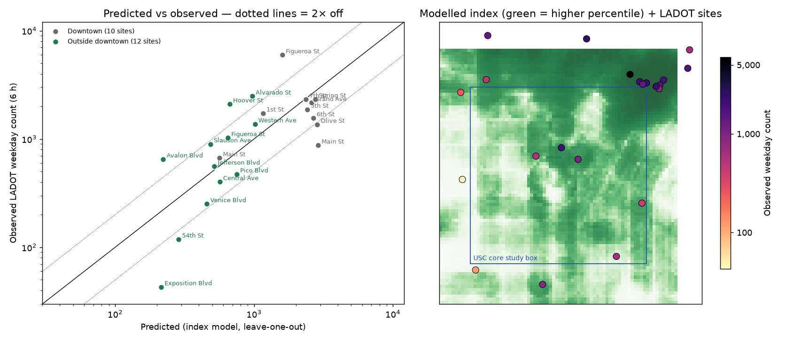

# Pedestrian activity model — Stage 2 validation (USC / Exposition Park)

Run 2026-10-13. Reproduce with:

```bash
python3 -I scripts/build_features.py . && python3 -I scripts/model_validate.py . && python3 -I scripts/plot_validation.py .
```

Outputs are in `out/`: `count_sites.csv`, `site_validation.csv`, `grid_predictions.csv`, `validation_report.json`, `validation.png`.



## 1. What the LADOT counts are (and are not)

| Question | Answer from the data |
|---|---|
| Sites | 22 street segments placed inside our download box. Their 62 site-year records come from 4 count years: 2019 (12), 2021 (21), 2023 (15), 2025 (14). Sites have 1–4 years each. |
| Dates | **Only the count year is published.** No count date, season or weather. Whether a count covers one day or averages several is not stated. |
| Periods | Weekday is **7–10 AM + 3–6 PM, published as one 6-hour total**. Weekend is **11 AM–1 PM, a 2-hour total**. No hourly or 15-minute breakdown. |
| Units | People walking past a screenline on the segment (persons per counting window). The data doesn't say whether both sidewalks are included. |
| Coverage | 20 of the 22 are major streets (primary/secondary), because LADOT picks arterials and bike corridors. 10 are in downtown, outside the USC core box. Only 4 are inside the core box. |
| Location precision | Placed by matching street names to OSM intersections, not official coordinates. 3 sites matched one end only. Exposition Blvd (Arlington–La Brea) is a long segment, so its point is approximate. |
| Edge effects | 4 sites have 400 m buffers that extend past the OSM/business download box (1st St, Alvarado, Main/Arcadia, Western), so their food and business features are undercounted. |
| License | No license is stated in the metadata. **Use for validation only until LADOT confirms.** |

**How repeatable the counts are.** This is a ceiling on how well any model can do. The same site differs by a median of **26 %** between count years. Predicting a site-year from that site's own other years is typically off by **×1.41** (median error 20 %). 2021 (COVID) looks unusual: Figueroa 7th–8th fell from 9,077 (2019) to 3,920 (2021). One record is suspect: Grand Ave weekend 2023 = 35, when other years show 564 and 884. It is kept as published.

## 2. Features (per location, buffers fixed before looking at the counts)

| Feature | Source | Buffer |
|---|---|---|
| Food places (restaurant, fast food, café, bar…) | OpenStreetMap 2026-10-12 | 400 m |
| Storefront businesses (NAICS 44-45, 722, 812; ≤5 per exact coordinate) | LA City active business listing | 400 m |
| Jobs | LODES 2023 workplace | 800 m |
| Residents | Census 2020 blocks | 800 m |
| Street intersections (≥3 arms, no footways or motorways) | OpenStreetMap | 400 m |
| Weekday scheduled bus + rail departures (Wed 2026-10-14) | LA Metro GTFS | 400 m |

## 3. Models and cross-validated results

Target: weekday 6-hour count, geometric mean across a site's years. Every number below is **out-of-sample**: a site's own count is never used to predict it. Leave-one-out holds out one site. "Spatial blocks" holds out a whole cluster of sites within 1.5 km of each other (all of downtown at once), which is the stricter test.

| Model | Rank corr. (LOO) | 95 % CI | Pairs ordered correctly | Above/below median correct | Typical error (LOO) | Typical error (spatial) |
|---|---|---|---|---|---|---|
| Predict the average (null) | — | — | — | — | ×3.1 | ×3.7 |
| **Equal-weight index** | **0.68** | 0.31–0.87 | 74 % | 20 / 22 | **×2.1** | ×3.0 |
| Ridge regression (6 features) | 0.60 | 0.20–0.84 | 71 % | 18 / 22 | ×2.4 | ×2.2 |
| Random forest | 0.59 | 0.20–0.79 | 69 % | 16 / 22 | ×2.2 | ×2.4 |

* The **index with no count information at all** (ranking only) has rank correlation **0.73** (permutation p < 0.001).
* More complex models do **not** help with 22 sites. Ridge and the forest rank worse than the equal-weight index.
* "Typical error ×2.1" means a predicted 1,000 is usually somewhere in about 470–2,100.
* Sensitivity checks keep the same picture. Dropping 2021 gives index ρ 0.74. Dropping the 4 edge sites gives ρ 0.66. Weekend 2-hour counts give ρ 0.68.
* **Single features:** transit departures (ρ 0.71), food places (0.69) and jobs (0.69) carry most of the signal. Intersection density is *negatively* related (−0.21). Downtown's large blocks mean few intersections but very high counts. It stays in the index because the index was fixed in advance, and dropping it now would be tuning to these 22 points.

### Where it works and where it doesn't

* **Outside downtown (12 sites):** index ρ = **0.76**, permutation p ≈ 0.002. This group is the most relevant to the USC area.
* **Inside downtown (10 sites):** ρ = **0.16**. 8 of the 10 downtown sites score at the 97th–100th percentile. The model can say "downtown is busy" but cannot rank blocks within it.
* **USC campus edge is underpredicted ×2–3** (Hoover St: 2,100 observed vs 670 predicted; Figueroa at 30th: 1,025 vs 650). Students aren't captured: LODES puts all 22,141 USC jobs on one block, and there is no enrollment or class-schedule data.
* **Biggest miss:** Figueroa 7th–8th (5,965 observed vs 1,600 predicted), next to the 7th St/Metro Center station entrance.

## 4. Decisions for the app

1. **Show a relative index (percentile within the study area), not pedestrian counts.** Ranking is validated, moderately (ρ ≈ 0.7). Absolute counts are off by ×2–3, which is too loose to display as numbers.
2. **Use the equal-weight index**, not ridge or forest. It is simpler, needs no fitting to the counts, and validated as well or better.
3. **No hourly predictions.** The counts have no hourly data. Time-of-day and day-of-week changes in the app must be labelled **assumptions**. The only observed time-of-day data is Metro's *scheduled departures by hour* (transit supply, not people), in `out/transit_hourly_supply.json`.
4. **Flag low-confidence areas.** 17 % of grid cells have at least one feature outside the range seen at the count sites. Minor and residential streets (78 % of cells) were never counted.
5. **Show the 22 LADOT counts on the map as observed data**, with year and counting window, separate from modelled values.

## 5. Ways to improve accuracy (not done)

* More counts in the same format: LADOT has about 80–100 sites per year citywide. Using them would need OSM and business data for the whole city, which means a new download.
* USC/campus inputs (enrollment, building footprints, dorm capacity) and Metro station ridership (boardings by station are published monthly).
* The UC Berkeley SafeTREC/CAT counts portal needs a free account, which only you can create.

## 6. App integration (Stage 3, 2026-10-13)

`scripts/export_app_data.py` writes `public/data/usc-model-v1.json`. The app reads it through `src/data/usc/uscModelProvider.ts`.

* **One percentile scale.** Each cell's percentile is computed once over all 6,156 grid cells. Filters never recompute it. The map draws five fixed classes (quintiles).
* **Low-confidence flags per cell:** minor/residential street (78 % of cells), feature outside the range of the count sites (17 %), and the USC campus-edge zone (378 cells). The campus-edge zone is a judgement call: the campus block (Jefferson / Figueroa / Exposition / Vermont) plus 500 m, drawn because both campus-adjacent count sites were under-predicted.
* **LADOT comparability checks** (re-run at export):
  * Published totals equal weekday + weekend in 61 of 61 records.
  * 2021 weekday counts are a median 13 % lower than other years at the same 19 sites.
  * 3 sites were counted in one year only.
  * 1 weekend value is flagged (Grand Ave 2023 = 35).
  * The app shows each year's weekday (6 h) and weekend (2 h) totals as published. It never averages them, converts them to per-hour figures or calls them live.
* **No blending.** The simulated all-LA source is a separate mode. Outside the model box the USC source returns no values; it never falls back to simulated ones.
* **Scoring with percentiles.** For percentile signals, the business-type time weights are made relative to each business's best slot, and the simulated-mode ×1.25 gain is dropped. Without this, the top fifth of the area clamps to 100 and rankings tie. The time weights are still assumptions and are labelled that way.
* **Competitors** are 735 OSM food places in the area. Cuisine comes from the OSM tag (505), name keywords (54) or amenity type (17); the other 159 count as "other food". Vehicle traffic is not used.
